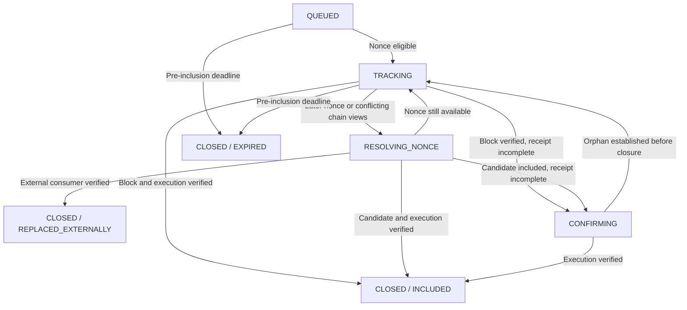

# Broadcaster API and lifecycle

[English README](../README.md) · [简体中文](api.zh-CN.md) · [Mainnet configuration](../config.mainnets.json)

[Setup](#setup) · [EVM API](#evm-api) · [Non-EVM API](#non-evm-api) · [Lifecycle](#lifecycle) · [Webhooks and recovery](#webhooks-and-recovery) · [Providers](#providers) · [Verification](#verification)

## Setup

Build and start the server from the repository root using the [quick start](../README.md#quick-start). The default listener is `127.0.0.1:8080`. Terminate HTTPS at your reverse proxy when exposing the service. Keep the same database and storage key across restarts.

| Setting | Purpose |
|---|---|
| `-config`, `-db` | Paths to your private configuration and local SQLite database. The Ethereum example covers one chain. The mainnet configuration covers all 18. |
| `BROADCASTER_STORAGE_KEY` | Base64-encoded 32-byte encryption key for provider credentials. Back it up with the database. |
| `clients[].name`, `token`, `admin` | Each service has a unique name and bearer token (at least 24 bytes). Admin clients also manage providers. Lookups and mutations use the submitting client's identity. |
| `clients[].webhook`, `webhookSecret` | HTTPS callback URL and signing secret (at least 24 bytes). Tokens and signing secrets can reference environment variables. |
| `networks` | Keys are decimal EVM chain IDs, a Solana cluster name, or a native network name. Configure allowed Solana fee payers and the cluster genesis hash. |
| `workers`, `trackingHours` | Defaults are four task workers and a 24-hour pre-inclusion tracking deadline for EVM and native families. Solana uses blockhash expiry and finalized history. |
| `defaultProbeFile` | Signed probes for the built-in provider, relative to the configuration file. Existing `publicNodeProbeFile` configurations are supported. |

For example, this client receives signed task results. Set both environment variables privately before startup.

```json
{"name":"wallet","token":"${BROADCASTER_API_TOKEN}","webhook":"https://payments.example.com/broadcaster","webhookSecret":"${BROADCASTER_WEBHOOK_SECRET}"}
```

All HTTP calls below use `Authorization: Bearer <token>`. Send JSON bodies with `Content-Type: application/json`. HTTP 202 means the task was persisted. A duplicate submission of an already registered transaction normally returns 200 and its original task. Errors include `error` and an optional `detail`. SQLite uses WAL, foreign keys and full synchronous commits. Use SQLite's online backup facilities or checkpoint the WAL before an offline file copy.

## EVM API

| Function | Method and path | Input and result |
|---|---|---|
| Submit a signed transaction | `POST /EVM/transactions` | Body `{"rawTransaction":"0x…"}`. Accepts chain-bound legacy, Type 1, 2 and supported Type 4 transactions. Optional `?chainId=1` must match the signature. Returns `taskId`, `network`, `txHash` and `state`. |
| Query progress or reconcile payment | `GET /EVM/transactions/{hash}` | Use any candidate hash. Returns the task, candidate versions, individual provider responses and on-chain evidence. Unknown or inaccessible hash returns 404. |
| Schedule an immediate broadcast | `POST /EVM/transactions/{hash}/force` | Body `{"reason":"operator requested send"}`. Bypasses local nonce ordering for an eligible active version. Provider health and chain checks still apply. |
| Replace a transaction | `POST /EVM/transactions/{hash}/replacement` | Supply a new signed `rawTransaction` for the same chain, sender and nonce. The path identifies the active version. Old hashes remain under observation. |
| Inspect an account queue | `GET /EVM/accounts/{address}/queue?chainId=1` | Lists this client's open tasks in nonce order. |
| Get a suggested signing nonce | `GET /EVM/accounts/{address}/nonce?chainId=1` | Optional `blockTag=latest` (default) or `pending`. Returns decimal strings `chainNonce`, `nonce`, and optionally `pendingNonce`. |

Hash routes accept a `chainId` query parameter. Supply it when the same identifier is ambiguous. Older clients can still use the paths without the `/EVM` prefix.

Example submission response (identifiers abbreviated):

```json
{"taskId":"task_42","network":"1","txHash":"0x…","state":"QUEUED"}
```

### Nonces and replacements

A nonce query picks a healthy RPC at random and tries another if the read fails. The service reads `latest` from the chain. For a pending view it also reads `pending` from the same node, starts at the higher value and skips occupied local slots across all submitters. If the chain returns 20 and the queue holds 20, 21 and 23, the suggested nonce is 22. This is a snapshot. Two signers can receive the same suggestion. Only submitting the signed transaction claims the slot. If every read fails, the API returns 503 `NONCE_VIEW_UNAVAILABLE`.

Ordinary submission returns 409 `NONCE_CONFLICT` when another active transaction occupies the slot. Resubmit identical bytes after a lost response, or use the explicit replacement route for an intentional fee bump. A verified external consumer can cause 409 `NONCE_CONSUMED` at intake. For an existing task, Broadcaster first checks all candidate hashes and the canonical block, then reports `REPLACED_EXTERNALLY` with `consumingHash`. A single node's “nonce too low” reply starts an investigation. It cannot establish which transaction landed.

### Sponsored EIP-7702 transactions and ERC-4337 bundles

For a new delegation, the user signs an authorization using the user's account nonce. The sponsor signs the outer Type 4 transaction using the sponsor's nonce. Broadcaster schedules the **outer sender**. For later calls under an existing delegation, the user signs the operation required by the delegated contract; the sponsor signs the outer transaction calling the user's account. The contract controls replay protection for the inner operation.

Read the outer receipt and the individual `attempts[].authorizations` separately. A successful outer transaction may skip an authorization. Diagnostics include the authority, delegate, nonce, prediction and reason. Transaction-level prestate evidence enables `APPLIED` or `SKIPPED` for state-dependent checks. Without it, `UNKNOWN` preserves uncertainty for the affected entry. [EIP-7702](https://eips.ethereum.org/EIPS/eip-7702)

For ERC-4337, submit the **bundler-signed outer transaction** targeting EntryPoint. The bundler accepts individual UserOperations, manages the mapping from `userOpHash` to the outer candidates and obtains each operation's outcome through `eth_getUserOperationReceipt`. A bundle can land with different execution outcomes for its operations. Configure the relevant EntryPoint addresses when admitting providers. [ERC-4337](https://eips.ethereum.org/EIPS/eip-4337) · [Bundler RPC](https://eips.ethereum.org/EIPS/eip-7769)

For example, the sponsor may sign two payments with outer nonces 100 and 101. If the delegated contract also requires sequential operation numbers 7 and 8 from the same user, the signing service coordinates both sequences. An external transfer by the user can invalidate an unused authorization. The sponsored outer transaction continues to be tracked by its own hash. An applied delegation may survive a revert in outer execution. [EIP-7702 authorization processing](https://eips.ethereum.org/EIPS/eip-7702#behavior)

## Non-EVM API

| Network | Submit | Query | Signed input and lookup key |
|---|---|---|---|
| Solana | `POST /solana/transactions` | `GET /solana/transactions/{signature}?cluster=solana` | Fully signed legacy or v0 transaction in Base64. The fee payer's signature is the transaction ID. |
| Bitcoin | `POST /networks/bitcoin/transactions` | `GET /networks/bitcoin/transactions/{hash}` | Hex wire transaction with unlocking script or witness. Use txid, including for SegWit. |
| TRON | `POST /networks/tron/transactions` | `GET /networks/tron/transactions/{hash}` | Hex protobuf transaction with signatures. Use the txID derived from raw_data. |
| Aptos | `POST /networks/aptos/transactions` | `GET /networks/aptos/transactions/{hash}` | Base64 BCS SignedTransaction. Use the user transaction hash. |
| Sui | `POST /networks/sui/transactions` | `GET /networks/sui/transactions/{hash}` | Base64 BCS TransactionData plus a `signatures` array of Base64 UserSignatures. Use the transaction digest. |
| TON | `POST /networks/ton/transactions` | `GET /networks/ton/transactions/{hash}` | Base64 single-root external inbound message BOC. Use the normalized message hash returned at intake. |

Native bodies use `rawTransaction`. Sui also requires `signatures`. The native submission response names the lookup field `txHash`; Solana returns `signature`.

### Solana sponsorship and re-signing

```json
{"cluster":"solana","paymentId":"order-47","signedTransaction":"<Base64 signed bytes>","context":{"slot":123456},"lastValidBlockHeight":123600}
```

Use the actual slot and last valid block height from the signing-time `getLatestBlockhash` response. The user and an allowed fee payer sign the same message. Each payment runs independently. Keep `paymentId` stable for retries. A different signed transaction submitted through the ordinary endpoint for the same payment returns 409. Durable nonce transactions require a different expiry protocol and are rejected at intake.

| Observation | What happens next |
|---|---|
| Bytes accepted by RPC, submission timeout, or only `processed` | Keep observing the original signature. Resend identical bytes while valid. |
| `confirmed` or `finalized` with an execution result | Record signature and slot. Explicit null `err` means success. A populated `err` carries the native execution failure. |
| Signature in a block but metadata missing | Enter `CONFIRMING` and check transaction metadata. A finalized inclusion always waits for its execution result. |
| Validity window passed | Enter `CHECKING_EXPIRY`. Verify finalized height and blockhash validity, then walk finalized parents and their signature lists. Persist the cursor across restarts. A missing index entry, a gap in the archive, or a timeout cannot authorize a second payment. |
| Previously confirmed fork disappears | Retain the observed slot during the scan. Only a complete finalized proof covering that slot and the signing window permits re-signing. Conflicting providers or a newer processed observation delay it. |
| Finalized history proves expiry and absence | Emit `solana.resign_required`. Both parties sign the same payment intent using a new blockhash. Submit it to `POST /solana/transactions/{signature}/resign`, pointing to the current expired signature, with the updated signing context. The new signature belongs to the original task. |

[Solana confirmation and expiration](https://solana.com/developers/cookbook/transactions/confirmation) · [Reported false timeouts and lagging RPC views](https://github.com/solana-labs/solana/issues/23949)

The re-sign request uses the same fields as submission. Keep the same client, cluster, payment ID, fee payer and payment instructions. An old lookup signature still resolves to the task. Resubmitting an already registered version is idempotent, while a different version against a stale signature returns 409. A `processed` observation above the finalized scan root needs a newer root before it can be excluded.

### Native inclusion evidence

Bitcoin checks the transaction and active block header via a synced txindex. TRON checks WalletSolidity transaction info and the matching block transaction. Aptos requires a committed user transaction and ledger version, Sui a checkpoint and effects status, and TON an indexed transaction whose inbound message and block reference match. Query fields include each provider's deliveries and chain-specific evidence. TON reports the receiving account transaction; downstream messages can have their own outcomes.

| Chain | Gateway requirements |
|---|---|
| Bitcoin | Bitcoin Core JSON-RPC with a synced txindex. Submit via `sendrawtransaction`. |
| TRON | Root URL serving Wallet and WalletSolidity HTTP APIs, including `/wallet/broadcasthex`. |
| Aptos | Fullnode REST root (usually `/v1`). Submit raw BCS to `/transactions`. |
| Sui | gRPC v2 over HTTP(S), with `ExecuteTransaction` and `GetTransaction`. |
| TON | One gateway serving both v2 `sendBoc` and v3 indexed message lookup. |

For example, Sui accepts `{"rawTransaction":"<base64 TransactionData>","signatures":["<base64 UserSignature>"]}`. The signer handles Bitcoin inputs, TRON expiry, Aptos sequence numbers, Sui object references and TON wallet replay protection.

After a TRON `TRON_SIGNATURE_WEIGHT_INSUFFICIENT` rejection, resubmit the same transaction with all existing signatures plus the missing signature(s). The service updates the pending task under the same txID. Retrying the old subset cannot discard newly added signatures. Incompatible changes return 409 `SIGNED_ENVELOPE_CONFLICT`.

## Lifecycle

A task groups one payment and its signed candidates. A delivery describes one candidate sent to one provider. The first acknowledgement moves the candidate to pending. Other providers still report their own results.

| Task state or outcome | Entry condition | Next action |
|---|---|---|
| `QUEUED` / `READY` | Signed bytes saved | Wait for nonce eligibility where applicable and an available provider. |
| `TRACKING` | Broadcast or ongoing chain observation | Inspect every candidate. An interrupted send is ambiguous. A replacement changes the active candidate but an earlier candidate can still win. |
| `RESOLVING_NONCE` | Confirmed EVM nonce advanced, or canonical views disagree | Pause this slot. Check candidates, authorizations and canonical block. Resume scheduling if the earlier observation was displaced. |
| `CONFIRMING`, execution `PENDING` | Inclusion verified with missing execution data | Stop sending and poll. A proven EVM orphan can return to tracking. For a displaced Solana fork use finalized history as described above. |
| `CHECKING_EXPIRY` / `RESIGN_REQUIRED` | Solana validity lost | Verify the full signing window; request new signatures only after exclusion. |
| `CLOSED / INCLUDED` | Inclusion and execution result verified | Record winner, evidence, success or failure, and enqueue completion. Other viable candidate hashes become replaced. |
| `CLOSED / REPLACED_EXTERNALLY` | Identified external consumer of this nonce | Record consumer, notify the submitting service and wake queued transactions. |
| `CLOSED / REJECTED` or `EXPIRED` | Locally provable invalid bytes, or pre-inclusion tracking deadline | Stop active work. An expired local task may still land; reconcile before paying again. |

Closing records the chain view at observation time. The submitting service applies any additional finality policy. Historical tasks already closed with `INCLUDED / UNKNOWN` can be enriched by querying their hash.

### Candidate and provider states

Each signed hash has its own history. A dispatch moves an eligible candidate through `BROADCASTING`. At least one matching acknowledgement yields `PENDING`. If every response is ambiguous, the candidate becomes `SUBMISSION_UNKNOWN`; check its local hash before another send. An explicit refusal can leave the candidate queued with a reason. A later timeout preserves earlier acceptance evidence. A replacement stops active sends for its predecessor. Both remain eligible to be the on-chain winner.

Inspect `queriedHash`, `activeHash`, `winningHash`, `consumingHash` and `attempts` to distinguish the version you queried from the one that landed. Per-provider deliveries move from `IN_FLIGHT` to `ACCEPTED`, `ALREADY_KNOWN`, `REJECTED` or `UNKNOWN`. Conflicting canonical block hashes or execution evidence postpone closure. A lagging reader cannot by itself disprove an inclusion verified by another provider.



### Failure fields

Intake errors appear in the HTTP error body. Broadcast errors belong to individual `attempts[].broadcasts[]` records, including `reason` and a bounded diagnostic detail. An all-provider refusal can report `evidence.providerReasons`. A timeout leaves submission uncertain. Explicit known-transaction replies count as acknowledgement, not execution. [Ethereum Execution APIs](https://ethereum.github.io/execution-apis/api/methods/eth_sendRawTransaction/) · [Geth operator report](https://github.com/ethereum/go-ethereum/issues/31451)

| Stage | Typical reasons | How to act |
|---|---|---|
| Admission or local queue | `INVALID_REQUEST`, `NONCE_CONFLICT`, `NONCE_CONSUMED` | Correct the payload, query the queue, or reconcile the consuming transaction. |
| Provider refusal | `NONCE_TOO_LOW`, `INTRINSIC_GAS_TOO_LOW`, `INSUFFICIENT_FUNDS`, `FEE_TOO_LOW` | Inspect individual providers and the current task. A fee change requires a newly signed replacement. |
| TRON signature validation | `TRON_SIGNATURE_WEIGHT_INSUFFICIENT`, `TRON_PERMISSION_DENIED`, `TRON_SIGNATURE_INVALID` | Add the missing authorized signature, or check signer permissions and signing bytes. |
| Included EVM failure | `EVM_OUT_OF_GAS`, `EVM_REVERTED`, `EVM_VM_ERROR` | Read top-level VM details and any revert reason in `evidence`. A failed receipt without diagnostic evidence produces `EXECUTION_CAUSE_UNAVAILABLE`. |
| Other included failure | TRON energy or revert reason, Solana instruction error, Aptos VM status, Sui effects error, TON phase exit code | Read `executionStatus`, `reason` and chain-specific `evidence`. |

## Webhooks and recovery

The state change and its outbound event commit in one SQLite transaction. Task leases allow another worker to resume after a crash. After an interrupted send, workers inspect chain evidence before retrying. Webhook delivery retries do not send the transaction again.

| Event | Action for the submitting service |
|---|---|
| `transaction.submitted` | Record the task or updated signed version. |
| `transaction.broadcast_rejected` | Inspect the current refusal and provider reasons. |
| `transaction.replacement_required` | Review the signed fee cap and prepare a same-nonce replacement if appropriate. |
| `transaction.included` | Show inclusion. Read `executionStatus`; it may still be pending. |
| `transaction.nonce_conflict` | Reconcile the external consuming hash. |
| `solana.resign_required` | Obtain fresh signatures for the existing payment. |
| `transaction.closed` | Use `data.taskOutcome`, `data.executionStatus` and `data.reason` to settle or report failure. |

Each request has `eventId`, `event`, `version` and a `data` task snapshot. Verify `X-Broadcaster-Signature` as the hex HMAC-SHA256 of the **raw request body**, using the configured secret and a constant-time comparison. `Idempotency-Key` equals `eventId`. Persist the event before returning 2xx. A lost response can produce the same event again.

Deduplicate by event ID. Compare state versions per task; distinct events can share one version when emitted by the same transition. Handle those event types independently, and keep an older snapshot from replacing newer order state. Failed callbacks back off, and HTTP 429/503 can extend the event retry through `Retry-After` (seconds or HTTP date, capped at 24 hours). Each configured client's delivery loop runs independently. After downtime, query the original hash to reconcile outstanding orders. [Webhook delivery considerations](https://docs.stripe.com/webhooks#event-ordering)

## Providers

| Function | Method and path | Result |
|---|---|---|
| Inspect built-in endpoints | `GET /rpc-providers/defaults?network=1` | Provider ID, URL, network and MEV flag; omit network to list configured presets. |
| Register and admit a provider | `POST /rpc-providers` | Submit `network` or `chainId`, `providerId`, optional custom `url` and `bearer`, plus signed probes. Returns 201 after checks pass. |
| Inspect runtime health | `GET /rpc-providers?chainId=1` | Endpoint ID, read health, height, circuit state, failure count and cooldown. |
| Update or disable an endpoint | `PATCH /rpc-providers/{id}` | Send changed fields. A custom route or credential change requires re-admission. Toggle `enabled` without resending probes. Built-in destinations are fixed. |

### Admission and mainnet presets

Use the provider ID from the catalog to admit a built-in URL. The probe file has the same probe fields as the admin request. For example, Ethereum's default configuration requires ordinary and Type 4 transactions and coverage of its configured EntryPoint.

```json
{"network":"1","providerId":"publicnode","evmProbes":["0x<ordinary>","0x<type4>","0x<signed EntryPoint bundle>"]}
```

These probes are real signed mainnet transactions. The service checks network identity, read access and write acknowledgement. EVM checks ordinary envelopes and Type 4 on the configured networks other than HyperEVM (999), plus signed bundle probes for configured EntryPoints. Solana uses `solanaProbe` in the submission format and verifies cluster genesis and fee payer. Other families use `nativeProbe` in their submission format. Failed probes leave the endpoint outside the pool. Restarts retain the admitted provider and any operator disablement.

The catalog below uses `publicnode` as the provider ID. A protection flag applies to the specific route. Concurrent delivery to another provider can expose the same bytes in a public mempool. [PublicNode directory](https://www.publicnode.com/)

| Mainnet | Endpoint | Provider label or protocol |
|---|---|---|
| Ethereum · 1 | `https://ethereum-rpc.publicnode.com` | MEV-Protected |
| BNB Smart Chain · 56 | `https://bsc-rpc.publicnode.com` | MEV-Protected |
| Base · 8453 | `https://base-rpc.publicnode.com` | MEV-Protected |
| Arbitrum One · 42161 | `https://arbitrum-one-rpc.publicnode.com` | MEV-Protected |
| Solana · mainnet-beta | `https://solana-rpc.publicnode.com` | MEV-Protected |
| Arc · 5042 | `https://arc-rpc.publicnode.com` | MEV-Protected |
| Robinhood Chain · 4663 | `https://robinhood-rpc.publicnode.com` | MEV-Protected |
| HyperEVM · 999 | `https://hyperliquid-rpc.publicnode.com` | Standard RPC |
| Bitcoin | `https://bitcoin-rpc.publicnode.com` | Bitcoin Core RPC |
| TRON | `https://tron-rpc.publicnode.com` | Wallet and WalletSolidity HTTP |
| Aptos | `https://aptos-rest.publicnode.com/v1` | Fullnode REST |
| Sui | `https://sui-grpc.publicnode.com:443` | gRPC v2 over TLS |
| OP Mainnet · 10 | `https://optimism-rpc.publicnode.com` | Standard RPC |
| Polygon PoS · 137 | `https://polygon-bor-rpc.publicnode.com` | Standard RPC |
| Avalanche C-Chain · 43114 | `https://avalanche-c-chain-rpc.publicnode.com` | Standard RPC |

| Mainnet | Provider ID | Endpoint | Source |
|---|---|---|---|
| Monad · 143 | `monad-foundation` | `https://rpc-mainnet.monadinfra.com` | [Monad Foundation network information](https://docs.monad.xyz/developer-essentials/network-information) |
| Plasma · 9745 | `plasma` | `https://rpc.plasma.to` | [Plasma mainnet details](https://www.plasma.org/docs/guides/network-configuration/mainnet-details) |
| TON | `toncenter` | `https://toncenter.com` | [TON Center API](https://docs.ton.org/ecosystem/api/toncenter/v3/overview) |

These three presets use ordinary broadcast routes. Public endpoints have rate limits. Monad Foundation designates its public endpoint for development. For production, register independently operated providers sized for your traffic. Mark a private route `mevProtected` only after checking the provider's service for that URL. Recheck the flag when changing the endpoint or credentials.

### Provider selection and recovery

Select one eligible endpoint per provider, prefer protected routes, and send immediately to up to three providers. With two or one available, send to all available providers. With zero, record `NO_AVAILABLE_PROVIDER` and leave the task scheduled. Keep collecting individual results after the first acknowledgement.

Height probes measure read availability and progress against peers or the endpoint's own history. A read probe cannot clear a write failure. Each chain and endpoint has its own durable broadcast circuit.

| Current state | Observation | Action |
|---|---|---|
| Healthy | Timeout, disconnection, rate limit, credentials or server failure | Count the endpoint failure. Three failures start a cooldown. |
| Cooling down | Deadline reached with work waiting | Lease one actual broadcast across all workers as a half-open trial. Late responses from older rounds cannot end a cooldown. |
| Half open | Further endpoint failures | Release the trial slot after each result. Three failed trials start the next cooldown. |
| Healthy or half open | Expected identifier or explicit already-known acknowledgement | Clear count and cooldown stage. |
| Healthy or half open | Transaction refused because of fees, nonce or balance | Record the reason against that transaction. Release any trial slot and retain the endpoint counters. |

Cooldowns last 3, 6, 10, 15, 21, 28, 36, 45, 55 and then 60 minutes per stage. Later stages stay at 60. If A accepts, B already knows the transaction and C times out, the transaction stays pending and only C accrues an endpoint failure.

## Verification

Run from the repository root. The tests create temporary databases and use local RPC fixtures.

```sh
go test -race ./...
go vet ./...
```

| Scenario | Expected result |
|---|---|
| Two services submit different payments with the same sender and nonce | One gets the slot. The other sees 409 and must query again before signing its independent payment. |
| A replacement is queued and the earlier candidate lands first | Both lookup hashes return the same task and winning hash, including a failed execution if the winning receipt reports one. |
| All sends time out and the worker restarts | The worker checks the original candidates before resending. Verified inclusion can complete the task without another successful send. |
| The user spends a queued nonce from another wallet | Verify the external hash and block, notify the original service and reschedule remaining tasks. Signed higher nonces retain their values. |
| Solana signature disappears after confirmation and archive data is missing | Keep the payment open. Resume from the verified cursor when archive data returns. |
| A webhook receiver responds slowly or returns 429 | Other clients continue receiving events. Retry the original event ID for the affected receiver. |

### Where to change the code

| Component | Files under `internal/broadcast/` |
|---|---|
| API and signed intake | `http.go`, `signed.go`, `nonce.go`, `store.go` |
| Task scheduling and persistence | `worker.go` claims tasks, `dispatch.go` records sends, `transition.go` commits outcomes and events. |
| Observation | `observe.go`, `receipt.go` and `reconcile.go` handle EVM evidence. `solana.go` and `solana_expiry.go` handle Solana. The five `native_<chain>.go` files implement the other chains. |
| Outbound notifications | `events.go` delivers persisted events. `schema.sql` defines the outbox and its indexes. |
